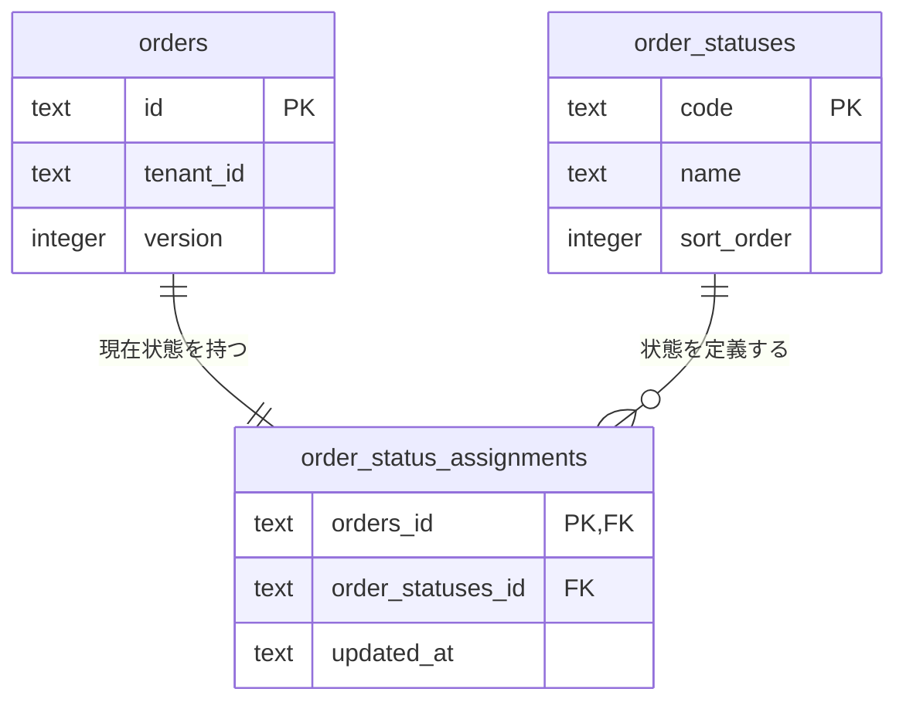

# ADR 007: 注文ステータスマスタと中間テーブル

## ステータス

採用。注文ライフサイクルは[ADR 006](006-order-lifecycle.md)に従います。
外部キー列の名前は[ADR 013](013-foreign-key-column-names.md)の参照先テーブル名に従います。

## 背景

注文のステータスを注文テーブルの文字列列だけで管理すると、ステータスの定義と表示名がDBで
分かりません。ステータスを独立したテーブルに置き、中間テーブルを通して参照します。

## 決定

- `order_statuses`: codeを主キーとし、日本語のnameとsort_orderを持つステータスマスタ。
- `order_status_assignments`: orders_idを主キーとし、order_statuses_idとupdated_atを持つ中間テーブル。
  orders_idはorders.id、order_statuses_idはorder_statuses.codeを外部キーで参照します。
- `orders.status`は削除します。現在状態の正本は中間テーブルです。
- 1注文の現在ステータスは1件です。中間テーブルの主キーで複数登録を防ぎます。
  複数の注文が同じマスタを参照します。注文削除時は紐付けを削除し、参照中のマスタ削除は禁止します。
- 作成は注文・中間テーブル・Outbox、更新は注文の更新番号・中間テーブル・OutboxをD1バッチで
  原子的に保存します。中間テーブルの更新も、楽観ロックに成功したイベントIDで条件付けます。
- 注文取得・一覧は中間テーブルとマスタをJOINし、APIのstatusコードを維持します。
  一覧のstatusLabelはマスタの日本語名を返し、画面はこの値を表示します。

マスタの初期データは下書き・確定・出荷済み・完了・キャンセル済みです。
表示名はマスタが担います。許可する状態遷移は引き続きOrder集約で検証します。
新しいステータスを追加する場合は、DBマイグレーションとドメイン・API・画面の操作を一緒に変更します。
マスタへの行追加だけで新しい業務フローを有効にはしません。中間テーブルは履歴ではなく現在状態を
表します。イベントの処理済み履歴はorder_event_historyに記録します。

## 選択肢

- ordersにstatus列を維持する：単純ですがマスタと参照関係がDBに現れません。
- ordersに直接マスタの外部キーを置く：テーブルは少なくできますが、中間テーブルによる管理の要件に合いません。
- マスタと中間テーブルを使う：JOINが増える一方、定義と現在状態の関係を独立させられるため採用。

## 移行・検証・影響

順番にマイグレーションを適用し、完了後に新しいアプリケーションを起動します。
移行中は旧アプリの注文APIを停止し、旧列と中間テーブルのずれや、旧列削除後の読み取り失敗を防ぎます。

1. 0004: マスタと中間テーブルを生成マイグレーションで作成。
2. 0005: カスタムデータマイグレーションでマスタを登録し、既存orders.statusを中間テーブルへ移行。
3. 0006: 生成マイグレーションで旧status列を削除。

既存行の中間テーブルupdated_atにはcreated_atを使用します。移行前の最終状態変更時刻は取得できません。
注文ID・明細・金額・更新番号・予約IDは維持します。未定義の旧ステータスは外部キー違反で移行を止めます。
移行の失敗時はアプリ更新を進めず、原因を直して未適用のマイグレーションから再開します。
旧アプリへのロールバックには、バックアップ復元または旧status列への逆移行が必要です。

ローカルD1で全5状態のデータ移行、旧列の削除、マスタの表示名の取得、複数状態・未定義状態の拒否、
状態更新の失敗時に注文・Outboxもロールバックすることを確認します。
既存の競合・在庫・決済テストと画面E2Eで注文ライフサイクルを引き続き確認します。
