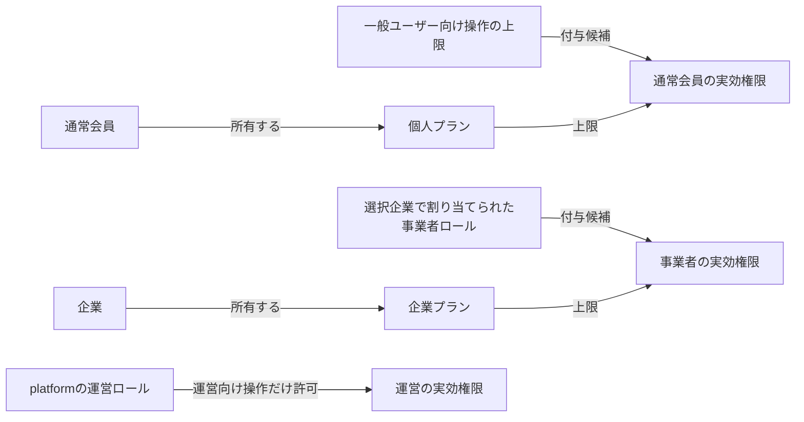

# ADR 020: 個人・企業プランでロールの実効権限を制限する

## ステータス

採用。開発段階のため、プラン定義とデモの割当を設定・seedへ直接用意します。既存利用者向けの互換移行は作りません。

## 背景

ロールの作成時だけプランを確認すると、ダウングレード後も保存済みロールの権限を使えてしまいます。
APIでも現在のプランを確認し、所属・ロール・本人注文の制約と組み合わせます。料金や課金の仕組みは実装していません。

## 決定

### 所有者と判定

- 通常会員は `customer_accounts.plan_code` に本人の個人プランを持ち、企業所属を必要としません
- 企業担当者は選択した企業の `organizations.plan_code` を使います。個々のbusiness_accountsにはプランを持たせません
- 運営は料金プランの対象外ですが、platform所属・ロールの操作権限とCloudflare Accessが必要です
- 実効権限はサービスの上限・ロールの権限・現在のプランで許可された権限の共通部分です。プランから権限を追加しません
- 未設定、未知のコード、別サービスのプランは業務権限なしとして扱います。登録確認・本人退会等のライフサイクルは維持します

### 変更時の動作

D1のQuery adapterは現在の会員・所属・ロール・プランコードを一緒に読み、検証済みの事実だけを返します。
applicationの `PlanAccessQuery` が設定済みプランを解決し、domainの `effectivePermissions` を呼びます。
商品画像を含むRPC、セッション、招待承諾時の発行者確認には同じapplication Queryを接続します。
Repositoryにはプラン一覧や権限の交差計算を置かず、判定の責務をapplication/domainへ分けます。古いIdentityやクライアント申告のプランは根拠にしません。
企業のプランを変更してもロール定義や所属は書き換えず、次のAPI認可から使える権限だけが変わります。

企業ロールの新規作成・権限追加は、そのロールを所有する企業のプラン内に限定します。
共有ロールを編集する人の個人プランは使いません。通常会員の実行時は本人の個人プランとの共通部分を使います。
既存の超過権限は定義として保持し、権限を減らす修正は許可します。UIも現在追加できる操作をサーバーから取得します。

ロールの委任範囲にはサーバー内部の現在の `rolePermissions` を使い、実行にはプラン適用済みの `permissions` を使います。
これにより自己昇格を防ぎつつ、現在の実効管理権限があれば下位プランでも保護オーナーの招待・移譲を行えます。
最後の有効なオーナー・運営管理者の削除・降格・退会の保護と、企業ごとのロール分離は維持します。
顧客プランをメールから推測せず、本人確認された独立した通常会員IDへ結び付けます。退会後の新会員へ引き継ぎません。

権限コード・表示名・許可サービスは `domain/access/policies/permission-catalog.ts` の同じ行で定義します。
検証用のコード一覧・表示ラベル・サービスごとの権限上限はこの定義から導出し、権限追加時に複数の一覧を手で同期しません。

### 開発設定とseed

定義は `apps/api/src/domain/access/policies/plan-catalog.ts` の小さな一覧に置きます。
各項目はコード・表示名・対象サービス・許可permissionだけです。現在は `customer:demo` と `business:demo` を用意し、
`apps/api/tooling/seeds/development-fixture.ts` と `seed-development.ts` がデモ会員・企業への割当と運営の `plan.manage` を直接設定します。商用プランや料金ではありません。

`pnpm db:migrate:local` でschemaを作成してから `pnpm db:seed:local` を実行します。
再seedは名前付きデモのプラン割当を指定値に揃えます。その他の会員・企業の割当は変更しません。

固定データはDBに依存しない `development-fixture.ts`、型付きinsert/upsertは `seed-development.ts`、
Wranglerの接続・永続化・終了処理は `tooling/seed-local.mjs` が所有します。
投入処理は呼び出し側からDrizzleの接続を受け取り、テストでは一時D1へ同じ処理を適用します。
権限の全件割当は既存のpermissionカタログ、プランコードはplanカタログから参照します。

CLIは配備設定からDBの識別子だけを一時設定へ取り出し、DO・Queue・認証には接続しません。
APIの `.wrangler/state/v3` を使い、`remoteBindings: false` でローカルへ固定します。
全INSERTを一度のD1 batchで実行し、途中失敗は全体をロールバックします。
権限INSERTを文ごとに分割してD1のパラメータ上限を避けます。
再実行時のロール変更・企業停止・IP設定・会員名は保持します。
退会済みデモ会員への所属再作成は既存DB制約で拒否し、復活させません。

[drizzle-seed](https://orm.drizzle.team/docs/seed-overview) は再現可能な架空データの生成向けです。
現在必要な固定・冪等なbootstrapはDrizzle insert/upsertを使い、生成ライブラリへの依存は追加しません。
大量データ生成が必要になった場合も、固定fixtureと分けて接続を呼び出し側から渡します。

seed以外で作る新会員・新企業は未割当です。自動的に広い権限を与えず、明示的なプラン割当を必要とします。

運営の `access.plans` は企業向けのプラン一覧、`access.assignPlan` は企業だけへの割当です。
両方に `plan.manage` が必要です。一般ユーザーは本人の会員情報で `access.customerPlans` と `access.changeCustomerPlan` を使い、自分のプランだけを変更・解除します。詳細は[ADR 030](030-customer-plan-self-service.md)を参照してください。
割当変更は既存のaccess_revisionと監査へ参加し、途中の権限変更との競合は409で原子的に拒否します。

## 選択肢

プランごとのロール複製や汎用エンタイトルメントエンジンは追加しません。
小さな設定と2列で所有者を明確にし、既存の認可に上限だけを重ねます。

## 影響

0015は2つの参照列、0016はpermission定義を追加します。0000〜0014の履歴は変更しません。
移行処理で既存のplanやロール権限を一括設定せず、開発用の初期値はseed/bootstrapが担当します。
料金、決済、購読状態、プラン編集画面、ClerkやCloudflare Accessの設定変更は含みません。
