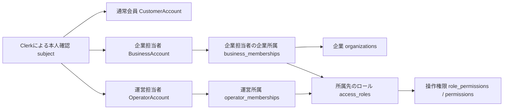
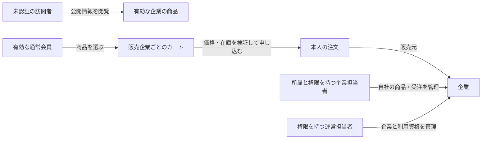

# 会員・所属・権限の業務モデル

この文書は現在のcommerceサンプルの仕様です。別業務の新規プロジェクトへ適用する際の手順は
[初期適用](../project-guide.md#別ドメインへの初期適用)を参照してください。現在のサンプルを保守する間は、以下の制約を維持します。

## 現行サンプルの業務制約

- 一般ユーザーの個人プランは本人だけが変更・解除する。APIは認証済み会員IDを使い、対象ユーザーID・会員種別・権限を入力として受け取らない。プラン未設定でも本人の選択を許可する。運営のプラン割当は企業だけを対象とし、一般ユーザーへの代理変更を拒否する。

- 注文を作成するのは一般ユーザーだけとする。企業は自社への受注を管理し、代理注文の作成経路を設けない。画面の非表示だけでなくAPIの会員種別とサービス権限上限で拒否する。

- 一般ユーザーは企業所属を持たない。企業メンバー一覧・所属操作・招待には企業担当者だけを含め、一般ユーザーの氏名・メール・会員IDを返さない。全ユーザー管理は運営の権限と個人情報閲覧の監査で保護する。商品・注文の販売企業との紐付けを、会員の企業所属と混同しない。

この図は現在の会員ライフサイクルを表します。DB全体のER図ではありません。
矢印は本人確認の対応または所有する会員・所属を示し、他サービスへの自動登録は意味しません。

- 本人確認と会員登録は別。共有subject・同じメールから登録や権限を自動作成しない
- 通常会員の退会は通常会員だけ、企業担当者の退会は企業担当者だけに作用する
- 一般ユーザーは企業所属を持たず、企業に紐付くのは商品・注文と企業担当者の所属。企業オーナーであることは通常会員の登録を意味しない
- 企業作成は運営の権限で行い、初期オーナーは企業担当者向け招待を承諾する
- 招待承諾は対象サービスの会員と所属を原子的に保存し、他サービスを作らない
- 退会行と会員IDを履歴として残す。再登録は新IDで、過去注文・所属・権限は引き継がない
- ロール・パーミッションは入場後の操作を許可する。サービス会員登録の代わりにならない

各会員は独立したエンティティとID型を持ちます。通常会員は自己登録と退会、企業担当者は招待登録と
最後のオーナーを保護する退会、運営担当者は招待登録と最後の管理者を保護する停止を別ユースケースで扱います。
名前・メールの単純な値と本人確認だけは共有できます。保存はそれぞれcustomer_accounts・business_accounts・
operator_accountsに対応し、共通Accountに種別を渡して状態遷移させません。
実装上の境界は[ADR 016](../adr/016-service-account-domain-models.md)を参照してください。

旧accounts・memberships・actor_qualificationsは0014以前の読み取り専用履歴です。
現在の入場判定や登録には使いません。移行対応表・監査原本も履歴の追跡用です。
一般ユーザーの所属廃止は[ADR 029](../adr/029-ordinary-users-without-organization-memberships.md)に従います。
判断理由・例外・移行は[ADR 015](../adr/015-independent-service-accounts.md)、
受け入れ条件は[企業・会員管理](use-cases/manage-organizations.md)を参照してください。

## 商品閲覧・購入と管理の境界

| 用語           | 意味とルール                                                                                                                                  |
| -------------- | --------------------------------------------------------------------------------------------------------------------------------------------- |
| 公開商品       | 有効な企業が持つ商品。現行モデルには公開状態がないため、商品名・SKU・価格・画像と販売元の公開情報をストアへ出す。会員情報や管理設定は含めない |
| カート         | 購入前に選んだ商品と数量。販売企業ごとに注文する。保存済みの価格は購入時の正当性を保証しない                                                  |
| 購入者         | 有効な通常会員。販売企業への所属は不要で、企業担当者の登録だけでは購入者にならない                                                            |
| 注文           | 購入者本人が申し込んだ明細と価格の履歴。本人の通常会員IDと販売企業を保存する                                                                  |
| ダッシュボード | 実データによる状況の要約と業務ページへの入口。注文・商品・企業の編集フォームを一画面に集めるものではない                                      |

公開閲覧と管理は別の手続きです。公開ストアを追加しても、管理手続きの企業所属・ロール・
プラン・企業画面のIP制限・運営画面のAccess検証は省略しません。
購入ではサーバーの商品価格と送信単価の一致を確認し、有料商品を0円にする改ざんは保存前に拒否します。
商品価格自体が0円の無料商品は注文できます。在庫不足も保存・予約前に拒否します。

例えば、通常会員が企業Aに所属せずに企業Aの商品を選び、購入確認後に注文を作成できます。
一方で企業Aの注文一覧・商品編集は、企業担当者として企業Aの所属と必要な権限がなければ利用できません。
購入者は自分の注文だけを閲覧でき、企業停止後も本人の過去注文は履歴として確認できます。
退会後の再登録は新しい通常会員IDになるため、以前の注文を自動的に引き継ぎません。

決済はデモ連携で実課金を行いません。送料、配送先、配送追跡、レビュー、広告、クーポンは
現行の業務モデルに含めません。これらを追加する場合は、画面の見た目だけでなく業務ルールとAPIの契約を先に定義します。

## 一覧の状態と検索の意味

注文の検索で状態を追加・変更しない。企業が受注を読む範囲は自社、一般ユーザーの履歴は本人の会員IDに限定する。
在庫一覧の「在庫あり／在庫切れ」は台帳の現在庫が1以上／0を意味し、予約差引後の購入可能数ではない。
企業の利用状態と企業契約プランは別の条件であり、一般ユーザーの個人プラン・所属と混同しない。
商品公開状態やカテゴリ、在庫警告しきい値は未定義のため検索条件へ追加しない。
設計と検証は[ADR 032](../adr/032-server-list-filters.md)を参照する。
