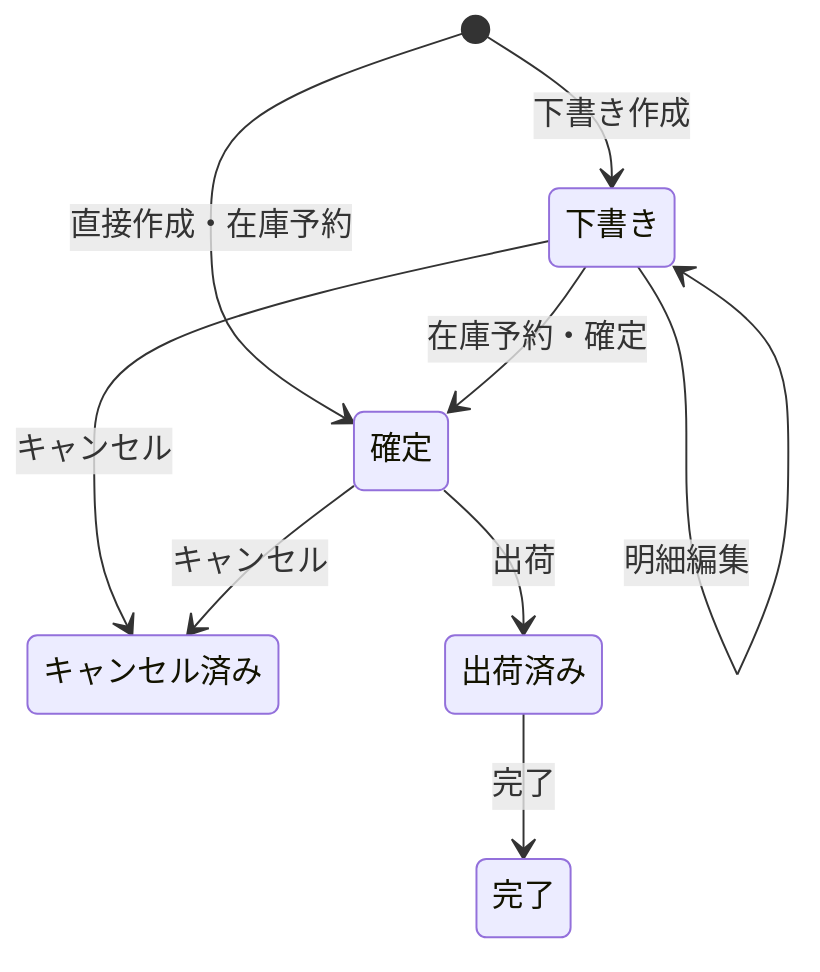
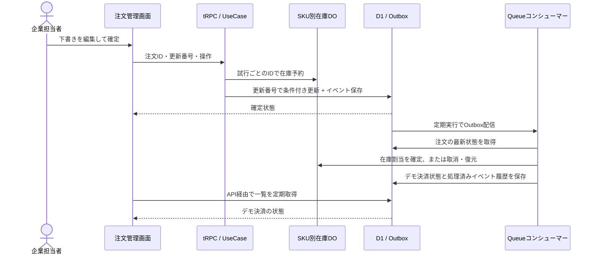

# 注文を編集・確定・キャンセル・出荷する

## 目的と対象

サンプルの注文管理を、作成だけでなく状態遷移、在庫との連携、非同期のデモ決済まで
画面から確認できるようにします。一般ユーザーが注文を作成し、企業担当者は自社への受注を管理します。
企業の注文作成ページは廃止し、代理注文はAPIと内部ユースケースで拒否します。
在庫は企業・SKU別に管理し、実決済は対象外です。

## 現在の業務ルール

| 状態           | 明細編集                                    | 次の状態         | 在庫・デモ決済                            |
| -------------- | ------------------------------------------- | ---------------- | ----------------------------------------- |
| 下書き         | 可。明細追加・削除、SKU・商品名・数量・単価 | 確定、キャンセル | 在庫予約なし、決済なし                    |
| 確定           | 不可                                        | 出荷、キャンセル | 確定時に予約。Queueで在庫割当と支払い承認 |
| 出荷済み       | 不可                                        | 完了             | Queueでデモの売上確定                     |
| 完了           | 不可                                        | なし             | 売上確定を維持                            |
| キャンセル済み | 不可                                        | なし             | Queueで予約解放・割当の在庫復元・承認取消 |

`order.create`は有効な一般ユーザーの会員IDを所有者として確定注文を作成します。`draft: true`を渡すと下書きを作成します。
確定後の明細変更、出荷後の取消、返品・返金は扱いません。これらは別ユースケースとして追加します。
数量は1〜100、単価は0〜10000000円、明細は1〜20件。同じSKUは一つの明細にまとめます。
合計0円の注文は支払い不要です。顧客注文は作成・下書き編集・確定時に選択企業の商品価格をサーバーで取得します。
入力単価（確定時は下書きの単価）が現在の商品価格と異なる場合は、保存・在庫予約前に400で拒否します。
有料商品の0円指定は拒否し、無料商品の0円指定は許可します。保存する商品名・単価はサーバーの商品情報を使います。
価格が変更された下書きは、現在の価格で再編集してから確定します。企業担当者による単価編集は従来どおり可能です。

## エンティティの状態型

Orderの状態は`Order<"draft">`などの型で表し、confirm・ship・complete・cancelを遷移元の型に限定します。
APIの操作要求は現在状態を確認してから各メソッドに渡します。保存データの復元も状態と値を検証します。
PaymentとStockReservationにも同じ方針を適用しています。
型と実行時の併用、在庫集約との関係は[ADR 008](../../adr/008-domain-state-types.md)を参照してください。

## ステータスの保存

`order_statuses`マスタにコード・日本語名・表示順を保存し、
`order_status_assignments`中間テーブルで注文と現在ステータスを紐付けます。
注文ごとの現在状態は1件です。注文テーブルにstatus列は持たず、APIはJOINして状態を取得します。
状態遷移の業務ルールはドメイン、表示名はDBマスタが担当します。
構成・移行手順は[ADR 007](../../adr/007-order-status-master.md)を参照してください。

## 処理の流れ

## 入出力と拒否条件

- `order.create`: 一般ユーザーだけが実行でき、企業・運営は403です。保存済みの企業ロールに作成権限が残っていてもサービス上限で除外します。
- `order.update`: 注文ID、version、lines。下書きの明細を更新します。
- `order.transition`: 注文ID、version、status（confirmed / cancelled / shipped / completed）。
- `order.list`: 同じテナントの注文・更新番号・デモ決済状態を返します。
- 未認証401、memberの更新403、他テナントや未検出404、入力不備400。
- 古い更新番号・禁止された状態遷移・在庫不足409。予期しない障害500。
- エラーは日本語。409では最新状態を取得して操作をやり直します。更新を自動再試行しません。

## 受け入れ条件と検証

- 一般ユーザーが注文を作成した後、企業が自社への受注を確認・管理できる。
- 企業はプロキシや自己申告ロールを変えても注文を作成できず、旧作成URLは404になる。

- 下書きの複数明細を編集すると合計と更新番号が変わり、在庫は予約しない。
- 確定時の在庫不足は注文を下書きのまま残し、途中まで取得した予約を解放する。
- 同じ更新番号の変更は一つだけ成功し、失敗した側のイベントをOutboxに残さない。
- Outboxの保存失敗は注文更新もロールバックする。
- 確定後の明細変更、出荷後のキャンセル、取消後の再確定を409で拒否する。
- memberや別テナントから更新できない。
- キャンセルイベントを再処理しても在庫を二重に戻さない。
- 取消後に古い確定イベントが届いても在庫を再び減らさず、決済も承認済みに戻さない。
- 保存が成功した直後の通信障害では、保存結果を確認して予約を保持する。
- 単体・HTTPテスト、ローカルD1でのトランザクションテスト、画面E2Eで確認する。

## 運用と制約

[ADR 006](../../adr/006-order-lifecycle.md)に再配信・競合・復旧方針を記録しています。
Queue反映は非同期なので、画面に「反映待ち」が出ることがあります。定期実行は1分ごとです。
一覧は5秒ごとに更新します。ローカルでは`curl http://127.0.0.1:5173/cdn-cgi/handler/scheduled`で定期実行を発火してQueueへ配信します。
実決済への送金は行いません。外部決済の失敗、Webhook、返金、出荷サービス連携は未実装です。

## Repositoryと取得の境界

注文取得は`OrderRepository.find`が検証・復元済みの`Order`を返します。ユースケースは
状態を絞って操作し、応答時にスナップショットへ変換します。注文一覧も`OrderRepository.list`のOrderを受け取り、表示DTOをapplicationで作るため、
DB由来の復元をユースケースへ持ち込みません。
